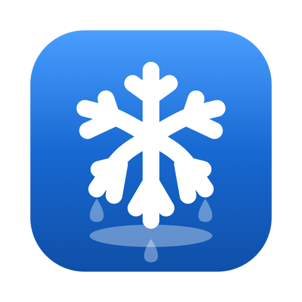

<p align="center"></p>

<h1 align="center">Cool Head</h1>

<p align="center"><em>Let cooler heads prevail.</em><br>Is your Mac running hot or slow? Cool Head says why in one sentence, with options to act in one click, plus tools to test your network, check your Mac's power and hardware, and clear space.<br>A free, open-source menu bar app for macOS.</p>

<p align="center">
  <picture>
    <source media="(prefers-color-scheme: dark)" srcset="docs/images/panel-dark.png">
    
  </picture>
</p>

## What it is

Activity Monitor shows numbers. Cool Head reads what a busy process is actually doing (its command, what started it, the files it writes, the progress it reports) and tells you, in one short sentence, whether that's fine:

> **Photo Export is 16% done. Ready around 8:26pm.**

> **Spotlight is indexing your files. That's normal.**

> **A Google Chrome tab is working hard.**

> **Google Drive is syncing your files.**

> **Memory is tight. Google Chrome is using the most (3.7 GB).**

A card worth watching has **Explore fixes**; a calm one has **Learn more**. Behind it are the options in two groups: **One click**, which Cool Head does for you, then **Do it yourself**, where Cool Head takes you to the right place and shows how. A safe one-click option is recommended over a task, marked **Recommended**; within each group, the options that do the most come first. An option with consequences that can't be undone or known is tagged **Caution** (stopping a program, force quitting, restarting a browser, or quitting an app in the middle of something: containers, a call, a game, a browser's tabs); quitting an app that asks to save, or that loses nothing, such as Slack, isn't. A task that does more than the recommended option, by fixing the cause, is tagged **Fixes the cause**. Each says in a few words what it would do. The clock in a card's corner hides it for 10 minutes, 30 minutes, or an hour, and it comes back sooner if things get worse.

It keeps a cool head: a big job isn't a problem just because it's big, and stopping is recommended only when a job has stalled. When Cool Head can't tell, it says so.

## What it knows

- **A warm Mac has a cause.** When your Mac warms up, each thing warming it gets a card with something to do, and the menu bar icon turns yellow.
- **Slow it down, don't stop it.** **Run it cooler** moves a job to the efficiency cores: slower, cooler, and undoable. Anything Cool Head is slowing, pausing, limiting, or has turned off is a frosted line in the **Managed by Cool Head** section at the top of the panel ("GoogleUpdater's background helper is turned off"), which is open whenever nothing else is, and folds to one line with its count while a card or tool is open; open, each line says what it is and since when, with the button to undo it on the line itself (**Speed up**, **Resume**, **Turn on**).
- **Chrome without quitting it.** It tells a busy tab, a busy extension, and Chrome's graphics work apart (also in Edge, Brave, and Arc), and offers what fits: run just that tab cooler, Energy Saver, turn off an extension, or close just that tab, before ever suggesting Quit. **Restart Chrome, keeping your tabs** closes Chrome normally (so it can ask about downloads) and reopens it with the same windows and tabs, freeing the memory it has built up; Incognito windows, unsent form text, and downloads in progress don't come back (also for Edge, Brave, Vivaldi, and Chromium).
- **The graphics chip counts.** An app keeping the graphics chip busy gets a card even when it uses little CPU, saying how much of the chip it uses.
- **Games come first.** A game is never slowed down; other busy work is offered to run cooler instead, to leave the game more power.
- **Sync apps can wait.** Google Drive, Dropbox, OneDrive, and Box: **Pause syncing** for a set time, with a reminder to resume. If a build is writing lots of files into a folder one syncs, its card says so: build output in a synced folder makes it upload every file.
- **Security software is left alone.** Your employer's security, device management, and VPN software is never offered Stop, Run it cooler, or Quit.
- **Battery Saver.** On battery, a really hungry job gets a card offering to pause it until you plug in. Nothing is lost, and it carries on by itself. A job you mean to run on battery can be trusted from its card.
- **Sleep and power.** It notices an app that has kept your Mac awake for hours, Low Power Mode left on with the charger while your Mac is busy, and a battery that drained while asleep because the Mac kept waking, and says what woke it.
- **Browser changes you didn't make.** It notices Chrome, Edge, or Brave managed by settings that adware uses (forcing an extension, or setting the search engine, home page, or a proxy) on a Mac no organization manages, and a browser a script started with an extension loaded from a folder.
- **Apps that keep crashing.** An app that crashed 5 or more times in a day, from macOS's own crash reports, with a way to look it up and see the reports.
- **Quiet hangs count too.** A process can be stuck while using almost nothing: paused by something else, waiting on a network drive that dropped, or an app macOS marks Not Responding. Each gets a card saying what started it and what may be waiting on it, with **Resume**, checking the drive, or **Force quit** (it asks first).
- **Always trust** an app or job you know is fine: it stays listed but calm, and is still flagged if it looks stuck, your Mac gets hot, or it runs nonstop for 8 hours.

<p align="center">
  <picture>
    <source media="(prefers-color-scheme: dark)" srcset="docs/images/pinned-dark.png">
    
  </picture>
</p>

## Privacy

Everything runs on your Mac. No account, no analytics, and nothing stored about what happened, except when memory was tight on this Mac in the last 30 days (when, how long, and the kind of program using the most, never a name), so it can tell whether memory is what slows your Mac and say how often on the This Mac page. Otherwise the only things it remembers are your own choices, kept on this Mac: apps and jobs you mark Always trust (listed under Trusted, along the bottom of the panel), reminders to resume a sync app you paused, jobs it paused for you until you plug in, the list of what the Cleaner moved to the Trash (so it can put each back; an item drops off once it leaves the Trash). The only automatic network use is a daily check with GitHub for a newer version of Cool Head (turn it off on the Settings page; see [docs/UPDATES.md](docs/UPDATES.md)). Four buttons reach outside, and only when you press them:

- **Look it up** opens a web search for the process name.
- **Share this case**, on cards Cool Head can't explain, shows you an anonymised report of that process.
- **Start test**, in Test my network, runs Apple's own network test, which downloads and uploads test data with Apple's servers for up to 30 seconds.
- **Report a problem**, along the bottom of the panel or under what Cool Head is managing, is for when a fix caused trouble or Cool Head isn't working: your own words plus Cool Head's activity from the last 6 hours (which cards appeared, which buttons were pressed, what happened), kept in memory only and anonymised the same way. What you type is kept if the panel closes or you open a tool, until you send it or press Cancel.

Reports never hold file names, paths, or project names. You see every word first; then **Open in GitHub** opens it as an issue for you to submit (posted under your GitHub account, only if you press Submit), or **Copy** keeps it on your Mac to send however you like. Details: [SECURITY.md](SECURITY.md).

## System requirements

macOS 15 Sequoia or later, on Apple Silicon or Intel. Cool Head still opens on macOS 14 Sonoma, but it isn't tested there, and a later version will need macOS 15. The updater won't install a version your Mac can't run.

## Quick start

1. Download the latest `Cool-Head-….zip` from [Releases](../../releases), and unzip it.
2. Move **Cool Head** to Applications and open it. The first time, macOS may say it can't check the app (it isn't notarized yet): open **System Settings ▸ Privacy & Security** and choose **Open Anyway**.
3. Look for the snowflake in the menu bar. Its badge shows the state by shape and color: a green circle when all is good, a yellow triangle when something is worth watching, a red octagon for a problem. Prefer something sillier? Pick the **Melting snowflake** on the Settings page (the gear at the right end of the panel's toolbar): it melts when something is slowing your Mac or needs a look, and bursts into flames for a serious problem, such as a stuck job, very tight memory, or macOS slowing it hard to cool it down.

<p align="center"></p>

Click the snowflake for the panel. At its top is how your Mac is running, in a row tinted green, yellow, or red: the snowflake whole, melting, or in flames, always the same as the menu bar icon's level; what's happening in a few words, such as "1 to watch" over "Memory is tight, so it's slower than it could be"; and, if you turn them on in Settings, round gauges under Usage, for how busy the chip and memory are, and under Temperature, for how hot the chip is, or the battery or drive when one is nearer its own limit, named under the ring. Its tools are along the bottom: This Mac (the model and serial number, how much of the startup disk is free with a button to macOS's Storage settings, the drive's life used, what it has written, its hours on, whether Time Machine backs it up, the chip's, battery's, and drive's temperatures, crash restarts in plain words, and port errors), Power (a battery with a bolt, or a plug on a Mac with no battery: the battery's health, and the three apps or programs that used the most energy this week from macOS's power log, with one click for the rest at 5% or more and every one in Nerdy stuff), Test my network (a test carries on if you close it or the panel, with dashes circling the globe while it runs (orange, or gray on an orange globe while Network is open) and the result's mark on it when it's done; its results stay for 30 minutes, with the time and date of the test), Cleaner (a hard disk with sparkles: Quick clean moves what nothing uses to the Trash with one click, such as background helpers whose program is gone and logs over 30 days old; Deep clean is a list to choose from, with what rebuilds itself ticked, such as Xcode's build data, and what Cool Head can't be sure of left for you to tick, such as settings panes in the System Settings sidebar whose app is gone; everything goes to the Trash, and Cool Head can put it back), and, at the right after a line, Report a problem, Trusted, and Settings. Settings has notifications, Open at login, automatic update checks (a minute after Cool Head opens, then once a day; you choose when to install), the version and the day it was released with Check Now, the menu bar icon (shown in pictures to pick from; both work without color, the badge by its shape and the snowflake by melting, then burning), whether the tools' names show, whether the gauges show (off to start), About, and Quit. Right-click the snowflake for a short menu: Settings…, About and Quit.

After that, Cool Head keeps itself up to date: when a new version is out, the panel offers to install it, and checks the download is genuine first.

Or build it yourself: see [BUILDING.md](BUILDING.md).

## How it decides

[docs/DIAGNOSIS.md](docs/DIAGNOSIS.md) explains the method: symptom, suspects, identify, state, match, card. The [catalogue](Sources/CoolHeadCore/Catalogue.swift) holds what Cool Head knows about common macOS processes, each with its source, and `coolhead selftest` checks every recorded example still gives the right card.

## Command line

The app includes `coolhead`, a command-line tool that prints the same cards as text: to read them in full, to paste into a report, or to use in scripts. To use it:

1. Open **Terminal**: it's in Applications ▸ Utilities, or press Command-Space and type Terminal.
2. Paste a command and press Return. Until you do step 3, start each command with the tool's full path, in quotes, because macOS doesn't know where `coolhead` is:

   ```bash
   "/Applications/Cool Head.app/Contents/MacOS/coolhead" now
   ```

3. To type just `coolhead` from then on, run this once, then open a new Terminal window:

   ```bash
   echo "alias coolhead='/Applications/Cool\ Head.app/Contents/MacOS/coolhead'" >> ~/.zshrc
   ```

   It adds one line to `.zshrc`, the file Terminal reads when a window opens. To undo it, delete that line. If you built Cool Head yourself, the tool is at `.build/release/coolhead` in the project folder instead (see [BUILDING.md](BUILDING.md)).

| Command | What it prints |
|---|---|
| `coolhead now` | The Mac's heat, power, battery, and memory, and a card for each busy process |
| `coolhead why <name or PID>` | One process's card, and the facts behind it |
| `coolhead case <name or PID>` | What **Share this case** would show for one process (nothing is sent) |
| `coolhead memory` | Who is using the memory, counted by app, and what could be done |
| `coolhead hangs` | What's paused, stuck waiting on a drive, or not responding |
| `coolhead hardware` | The drive, battery, crash restarts, and ports |
| `coolhead network` | How the Mac is connected; add `--test` to run Apple's network test |
| `coolhead history` | What used the most energy in the past week, and why the Mac woke |

**`<name or PID>`** stands for the process you're asking about. Type its name as Activity Monitor shows it, or its PID (the number in Activity Monitor's PID column), in place of `<name or PID>`, without the angle brackets:

```bash
coolhead why mds_stores
```

Part of a name is enough, and when several processes match, it picks the busiest. Put a name with spaces in quotes: `coolhead why "Google Chrome Helper"`.

What `why` and `case` print can include command lines and folder names. Read it before you paste it anywhere.

## Contributing

The most useful help is teaching Cool Head a pattern it doesn't know, or reporting a card it got wrong. See [CONTRIBUTING.md](CONTRIBUTING.md). Everyone whose work is in the project is listed in [CONTRIBUTORS.md](CONTRIBUTORS.md).

## License

Free and open source under the [GNU AGPL v3.0 only](LICENSE), with a commercial license for closed-source use: see [COMMERCIAL.md](COMMERCIAL.md). The name and logo are covered separately: see [TRADEMARKS.md](TRADEMARKS.md). Using Cool Head means you accept its [terms of use](TERMS.md): it's provided as is, its cards are its best judgement and not a guarantee, and what you choose to do with them is your responsibility.
