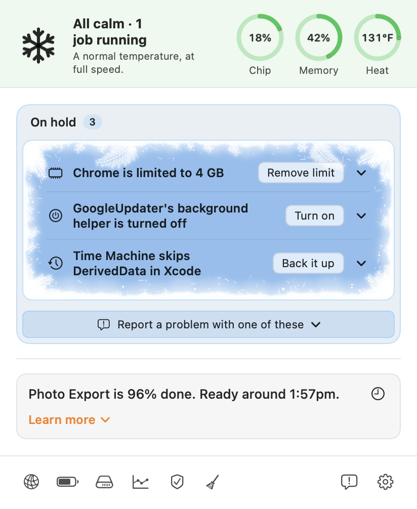
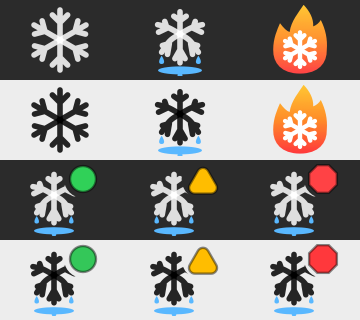

<p align="center"></p>

<h1 align="center">Cool Head</h1>

<p align="center"><em>Let cooler heads prevail.</em><br>Why is my Mac running hot or slow? What's happening, gathered from across your Mac into one place, with clear options to act in one click.<br>A free, open-source menu bar app for macOS.</p>

<p align="center">
  <picture>
    <source media="(prefers-color-scheme: dark)" srcset="docs/images/panel-dark.png">
    
  </picture>
</p>

## What it is

Activity Monitor shows numbers. Cool Head reads what a busy process is actually doing (its command, what started it, the files it writes, the progress it reports) and tells you, in one short sentence, whether that's fine:

> **Photo Export is 15% done. Ready around 1:52pm.**

> **Spotlight is indexing your files. That's normal.**

> **A Google Chrome tab is working hard.**

> **Google Drive is syncing your files.**

> **Memory is tight. Google Chrome is using the most (3.7 GB).**

A card worth watching has **Explore fixes**; a calm one has **Learn more**. Behind it are the options in two groups: **One click**, which Cool Head does for you, then **Do it yourself**, where Cool Head takes you to the right place and shows how. A safe one-click option is recommended over a task, marked **Recommended**; within each group, the options that do the most come first. An option with consequences that can't be undone or known is tagged **Caution** (stopping a program, force quitting, restarting a browser, or quitting an app in the middle of something: containers, a call, a game, a browser's tabs); quitting an app that asks to save, or that loses nothing, such as Slack, isn't. A task that does more than the recommended option, by fixing the cause, is tagged **Fixes the cause**. Each says in a few words what it would do. The clock in a card's corner hides it for 10 minutes, 30 minutes, or an hour, and it comes back sooner if things get worse.

It keeps a cool head: a big job isn't a problem just because it's big, and stopping is recommended only when a job has stalled. When Cool Head can't tell, it says so.

## What it knows

- **A warm Mac has a cause.** When your Mac warms up, each thing warming it gets a card with something to do, and the menu bar icon turns yellow.
- **Slow it down, don't stop it.** **Run it cooler** moves a job to the efficiency cores: slower, cooler, and undoable. Anything Cool Head is slowing is one frosted line at the top of the panel ("Slowing Photo Export to keep your Mac cool"), with **Speed up** to put it back.
- **Chrome without quitting it.** It tells a busy tab, a busy extension, and Chrome's graphics work apart (also in Edge, Brave, and Arc), and offers what fits: run just that tab cooler, Energy Saver, turn off an extension, or close just that tab, before ever suggesting Quit. When memory is tight, **Limit Chrome** sets Chrome's own memory limit (Chrome then says it's "managed by your organization"; restore it from the top of the panel). **Restart Chrome, keeping your tabs** closes Chrome normally (so it can ask about downloads) and reopens it with the same windows and tabs, freeing the memory it has built up; Incognito windows, unsent form text, and downloads in progress don't come back (also for Edge, Brave, Vivaldi, and Chromium).
- **The graphics chip counts.** An app keeping the graphics chip busy gets a card even when it uses little CPU, saying how much of the chip it uses.
- **Games come first.** A game is never slowed down; other busy work is offered to run cooler instead, to leave the game more power.
- **Sync apps can wait.** Google Drive, Dropbox, OneDrive, and Box: **Pause syncing** for a set time, with a reminder to resume. If a build is writing lots of files into a folder one syncs, its card says so: build output in a synced folder makes it upload every file.
- **Security software is left alone.** Your employer's security, device management, and VPN software is never offered Stop, Run it cooler, or Quit.
- **Save Battery When Unplugged.** On battery, a really hungry job can be paused until you plug in. Nothing is lost, and it carries on by itself.
- **Quiet hangs count too.** A process can be stuck while using almost nothing: paused by something else, waiting on a network drive that dropped, or an app macOS marks Not Responding. Each gets a card saying what started it and what may be waiting on it, with **Resume**, checking the drive, or **Force quit** (it asks first).
- **Always trust** an app or job you know is fine: it stays listed but calm, and is still flagged if it looks stuck, your Mac gets hot, or it runs nonstop for 8 hours.

<p align="center">
  <picture>
    <source media="(prefers-color-scheme: dark)" srcset="docs/images/pinned-dark.png">
    
  </picture>
</p>

## Privacy

Everything runs on your Mac. No account, no analytics, and nothing stored about what happened. The only things it remembers are your own choices, kept on this Mac: apps and jobs you mark Always trust (listed in the right-click menu), reminders to resume a sync app you paused, jobs it paused for you until you plug in, and the Chrome memory limit if you set one (so only that is ever removed). The only automatic network use is a daily check with GitHub for a newer version of Cool Head (turn it off from the right-click menu; see [docs/UPDATES.md](docs/UPDATES.md)). Three buttons reach outside, and only when you press them:

- **Look it up** opens a web search for the process name.
- **Share this case**, on cards Cool Head can't explain, shows you an anonymised report of that process.
- **Report a problem**, at the bottom of the panel and in the right-click menu, is for when a fix caused trouble or Cool Head isn't working: your own words plus Cool Head's activity from the last 6 hours (which cards appeared, which buttons were pressed, what happened), kept in memory only and anonymised the same way.

Reports never hold file names, paths or project names. You see every word first; then **Open in GitHub** opens it as an issue for you to submit (posted under your GitHub account, only if you press Submit), or **Copy** keeps it on your Mac to send however you like. Details: [SECURITY.md](SECURITY.md).

## System requirements

macOS 14 Sonoma or later, on Apple Silicon or Intel.

## Quick start

1. Download the latest `Cool-Head-….zip` from [Releases](../../releases), and unzip it.
2. Move **Cool Head** to Applications and open it. The first time, macOS may say it can't check the app (it isn't notarized yet): open **System Settings ▸ Privacy & Security** and choose **Open Anyway**.
3. Look for the snowflake in the menu bar. Its badge shows the state by shape and color: a green circle when all is good, a yellow triangle when something is worth watching, a red octagon for a problem. Prefer something sillier? Right-click it and choose **Menu Bar Icon ▸ Melting Snowflake**: it melts as things heat up, and bursts into flames when there's a problem.

<p align="center"></p>

Click the snowflake for the panel. Right-click it for updates, Save Battery When Unplugged, the menu bar icon, your trusted apps and jobs, reporting a problem, and Quit.

After that, Cool Head keeps itself up to date: when a new version is out, the panel offers to install it, and checks the download is genuine first.

Or build it yourself: see [BUILDING.md](BUILDING.md).

## How it decides

[docs/DIAGNOSIS.md](docs/DIAGNOSIS.md) explains the method: symptom, suspects, identify, state, match, card. The [catalogue](Sources/CoolHeadCore/Catalogue.swift) holds what Cool Head knows about common macOS processes, each with its source, and `coolhead selftest` checks every recorded example still gives the right card.

## Command line

The app includes `coolhead`, for Terminal and for scripts:

```bash
coolhead now
```

```bash
coolhead why <pid or name>
```

```bash
coolhead hangs
```

## Contributing

The most useful help is teaching Cool Head a pattern it doesn't know, or reporting a card it got wrong. See [CONTRIBUTING.md](CONTRIBUTING.md). Everyone whose work is in the project is listed in [CONTRIBUTORS.md](CONTRIBUTORS.md).

## License

Free and open source under the [GNU AGPL v3.0](LICENSE), with a commercial license for closed-source use: see [COMMERCIAL.md](COMMERCIAL.md). The name and logo are covered separately: see [TRADEMARKS.md](TRADEMARKS.md).
