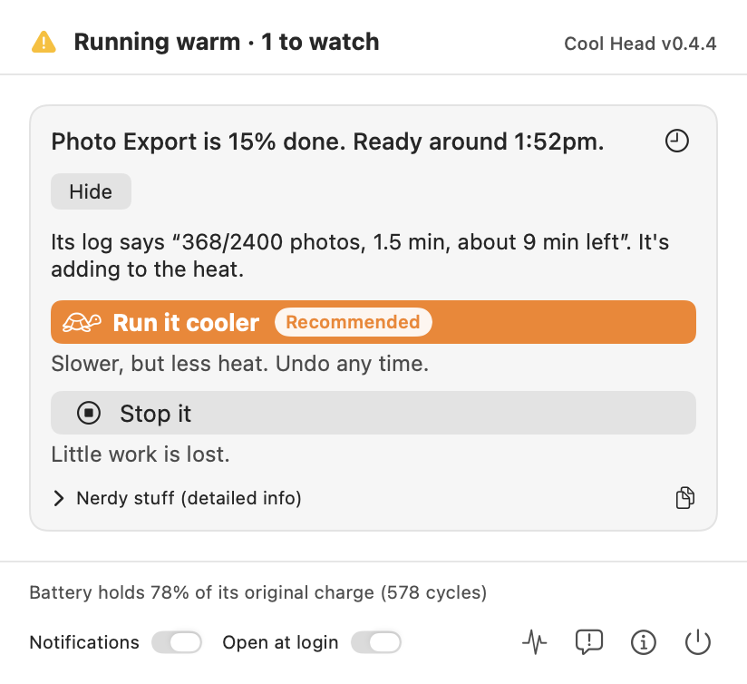

<p align="center"></p>

<h1 align="center">Cool Head</h1>

<p align="center">Why is my Mac hot? One sentence, one action.<br>A free, open-source menu bar app for macOS.</p>

<p align="center"></p>

## What it is

Activity Monitor shows numbers. Cool Head reads what a busy process is actually doing (its command, what started it, the files it writes, the progress it reports) and tells you in one sentence whether that is fine:

> **Your Photo Export job export.py is 45% done. Done around 11:49pm.**
> Let it finish

> **Spotlight is indexing your files. That's normal after a macOS update or when many files change, and it finishes on its own.**

> **Your Model job train.py has been busy with no progress since 9:46pm. It looks stuck.**
> Stop it · *It has done nothing new since 9:46pm, so stopping it loses nothing after that.*

It keeps a cool head: a big job is not a problem just because it is big. Stopping is only suggested when a job has stalled, and the card says what stopping would cost. When it can't tell, it says so and offers to look the process up.

It also connects the dots across the Mac: fast charging that adds heat, memory running short, and what needed a look earlier today.

## Privacy

Everything runs on your Mac. No account, no analytics, no network connections, and nothing stored about what happened. Two buttons reach outside, and only when you press them: **Look it up** opens a web search for the process name only, and **Share this case**, on cards Cool Head can't explain, shows you an anonymised report (no names, paths or files) and can open it as a GitHub issue that you choose whether to submit.

## System requirements

macOS 14 Sonoma or later, on Apple Silicon or Intel.

## Quick start

1. Download the latest `Cool-Head-….zip` from [Releases](../../releases), and unzip it.
2. Move **Cool Head** to Applications and open it. The first time, macOS may say it can't check the app (it isn't notarized yet): open **System Settings ▸ Privacy & Security** and choose **Open Anyway**.
3. Look for the snowflake in the menu bar. A dot appears on it when something needs a look.

Or build it yourself: see [BUILDING.md](BUILDING.md).

## How it decides

[docs/DIAGNOSIS.md](docs/DIAGNOSIS.md) explains the method: symptom, suspects, identify, state, match, card. The [catalogue](Sources/CoolHeadCore/Catalogue.swift) holds what Cool Head knows about common macOS processes, each with its source, and `coolhead selftest` checks every recorded example still gives the right card.

## Command line

The app includes `coolhead`, for Terminal and for scripts:

```bash
coolhead now
```

```bash
coolhead why <pid or name>
```

## Contributing

The most useful help is teaching Cool Head a pattern it doesn't know, or reporting a card it got wrong. See [CONTRIBUTING.md](CONTRIBUTING.md). Everyone whose work is in the project is listed in [CONTRIBUTORS.md](CONTRIBUTORS.md).

## License

Free and open source under the [GNU AGPL v3.0](LICENSE), with a commercial license for closed-source use: see [COMMERCIAL.md](COMMERCIAL.md). The name and logo are covered separately: see [TRADEMARKS.md](TRADEMARKS.md).
