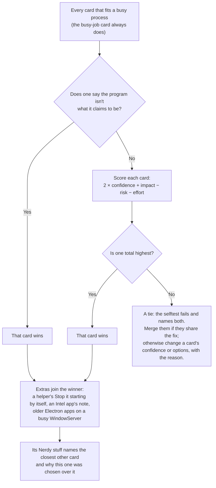

# How Cool Head works out the cause

Cool Head answers one question about anything keeping your Mac hot, busy or awake: **is this fine, and if not, what should I do?** It answers in one sentence and one action, and it says what acting would cost.

It never treats a big job as a problem just because it is big. Stopping something is only suggested when there is evidence it has stalled.

## The method

Every card comes from the same steps.

1. **Symptom.** What you would notice: the Mac is hot, the battery drains, it is slow, memory is tight, or it won't sleep.
2. **Suspects.** What contributes most to that symptom: for heat and battery, the processes using half a core or more, or half of the graphics chip or more, for at least a minute; for memory, the largest; for sleep, whatever is holding the Mac awake.
3. **Identify.** For each suspect, the facts a person would otherwise have to look up: its full command, the chain of parents up to the app or shell that started it, its working folder, the files it is writing, any lock files it holds, and how long it has been running.
4. **State.** Whether it is doing its job:
   - **working**: it reports progress that is still advancing, or it is still writing output;
   - **waiting**: it is queued behind another job, usually on a lock;
   - **stalled**: it has reported no progress for longer than 30 minutes and longer than three of its own usual gaps between progress lines;
   - **can't tell**: it has been busy for a long time with no sign either way.
5. **Match.** It is looked up in the [catalogue](../Sources/CoolHeadCore/Catalogue.swift) of known patterns: what it is, when it is normal, how long is normal, and the risk of stopping it.
6. **Card.** One sentence: what it is and whether that is fine. Behind **Explore fixes** (or **Learn more** on a calm card): how we know, and the options, each with its consequence, the recommended one first.
7. **Afterwards.** Whether the action helped. *(Planned: power and heat before and after.)*

Where these steps cannot reach an answer, the card says so plainly ("Can't tell whether it is working or stuck") and offers **Look it up**, a web search for the process name only. Cards that can't reach an answer, or that look stuck, also offer **Share this case**: an anonymised report of what Cool Head saw, shown in full first, which you can open as a GitHub issue. Shared cases are reviewed and become catalogue entries through pull requests; nothing reaches the catalogue automatically, and the catalogue only changes with app releases.

## What each state allows

Every card has one button: **Explore fixes** on a card worth watching, **Learn more** on a calm one. It opens how Cool Head knows (the evidence in a sentence or two) and the options, each with what it would cause, in two groups: **One click**, which Cool Head does for you, then **Do it yourself**, where Cool Head takes you to the right place and shows how. A safe one-click option is recommended over a task for you. Within each group, the options that do the most come first, and an option whose consequences can't be undone or known is marked **Caution** and is never the recommended one. Waiting isn't an option: the clock in each card's corner hides it for 10 minutes, 30 minutes, or an hour. Every option is a button: what Cool Head can't do itself, it opens the app where it's done (and says how), takes you to the settings page, shows the folder in Finder, or shows the steps under the option. What is recommended follows the state:

| State | Card says | Recommended | Stopping |
| --- | --- | --- | --- |
| working | how far along, and when it should finish | nothing while the Mac is cool; run it cooler when it's warm; pause until you plug in when it drains the battery | offered, saying how much work would be lost and what may be left half-written |
| waiting | what it is waiting for | nothing | offered, with the same warning (shown by `coolhead why`; the panel shows only processes busy enough to matter) |
| stalled | no progress since when | stop it (nothing since its last progress is lost) | recommended |
| can't tell | how long it has been busy | look it up, or share the case | offered, with a warning not to stop something unknown |

Some kinds of process have their own card, ahead of the states above:

- **The graphics chip.** How much of it each process uses comes from the IORegistry, where each connection a process opens to the graphics chip records the time the chip has spent on its work. Two readings 10 seconds apart give its share. A process keeping the chip busy says so on its card ("It's keeping the graphics chip busy, about 70% of it."). Run it cooler isn't offered for the graphics chip, since it slows a process's CPU work, not its drawing; an app can be quit instead. On a Mac whose graphics driver doesn't publish it, Cool Head sees CPU only.
- **Games** are calm and never slowed; while the Mac is warm, lower graphics settings is recommended. While a game runs, other busy work recommends Run it cooler.
- **Browsers** (Chrome, Edge, Brave, Arc): a tab, an extension, or the graphics process, told apart by their launch arguments, each with the options that fit.
- **Sync apps** recommend Pause syncing while the Mac is warm, with a reminder to resume. When a job writing over 100 KB a second works in a folder the sync app syncs, the card names the job and folder and recommends keeping that project out of synced folders instead: "probably" for the sync app's own folder, "may" for Documents or Desktop, which it may be backing up. Paths are compared as text; nothing in a synced folder is opened.
- **Security, device management, and VPN software** is never offered Stop, Run it cooler, or Quit.
- **Stuck while using almost nothing** (a hang): a process paused by something other than Cool Head (5 minutes; 30 for a job suspended in a Terminal window, which gets a calm card saying how to bring it back), one waiting on a disk or network drive that hasn't answered (2 minutes, from macOS's uninterruptible-wait state, naming the drive it has files on), or an app macOS marks Not Responding (1 minute). Each says what started it and which programs it started may be waiting on it. Resume is recommended for a paused process; checking the drive for a waiting one (nothing can stop it until the drive answers, so Stop isn't offered); for an app not responding, giving it a few minutes, then Force quit once it has been stuck and idle for 5 minutes. A process a debugger has paused is left alone. Files of a process waiting on a drive are never touched, so Cool Head can't get stuck on the same drive.
- **Trusted** apps and jobs stay calm until a limit is crossed: they look stuck, the Mac gets hot, or they run nonstop for 8 hours.

Stopping, running cooler and quitting are offered only for the person's own processes. Stop is never offered for macOS's own programs or for an app's main program; Quit is offered only for the main program of an app installed in an Applications folder. What stopping would cost is stated as "up to": Cool Head can see how long a job has run, not how much of that it has already saved.

## How a card is chosen

The catalogue is one of several checks. Each kind of card about a busy process is its own file in [`Sources/CoolHeadCore/Cards`](../Sources/CoolHeadCore/Cards), every card that fits a process is made, and the ranker in [`ProcessCard.swift`](../Sources/CoolHeadCore/ProcessCard.swift) chooses one. `coolhead cards` lists every card with the rule it comes from and the samples it must win.

The cards, by what they're about:

1. **Who it is**: a program pretending to be part of macOS, using a macOS name from outside macOS's folders without Apple's signature, or a background item labelled like Apple's that Apple didn't sign ([`Disguise.swift`](../Sources/CoolHeadCore/Disguise.swift)).
2. **Stuck**: macOS's own work that seems stuck, busy for over a day, judged by its priority and how long it has run, not by % CPU ([`BackgroundWork.swift`](../Sources/CoolHeadCore/BackgroundWork.swift)).
3. **What it's doing**: the catalogue (macOS's own processes that Cool Head knows by name, below); security, device management and VPN software; sync apps; Chromium browsers and apps built like them (a tab, an extension or the graphics process); a macOS service working for an app, such as decoding video for it, and web pages shown by another app, such as Mail, where the card names that app ([`Served.swift`](../Sources/CoolHeadCore/Served.swift)); web pages in Safari or another browser; and games.
4. **When nothing more specific explains it**: a macOS service that isn't in the catalogue, which the card says is part of macOS, working in the background; and anything else that's busy, by the states above (working, waiting, stalled, can't tell).

When more than one card fits the same process, each is scored on four things, from its own data, and the highest total wins (Phil, 17 November 2026: "prioritized in order of some aggregate of highest impact, lowest risk, highest confidence, lowest effort"):

- **Confidence**, how surely it fits, from 0 to 3: 3 when it knows this exact app, product or part of macOS (or the app says it's a game, or one of its own tabs); 2 when it knows what kind of program this is; 1 when it goes only by a process's name, which other programs can share; 0 for the busy-job card, which fits anything. **It counts twice.** That's a choice made against the samples, not a measured truth: with all four counted the same, a Chromium-style helper inside security software, a sync app or a game would get the browser-tab card and its "Run this tab cooler", and six cases would tie.
- **Impact** of its advice, the recommended option: 3 if it fixes the cause, 2 if it eases it, 1 if it only informs. A card that recommends nothing still tells you what's happening, so it counts as informing.
- **Risk** of its advice: 3 for Caution, 1 if it interrupts something, 0 otherwise. It's taken away.
- **Effort** of its advice: 1 for a task for you, 0 for one click or nothing to do. It's taken away.

Total: 2 × confidence + impact − risk − effort.

One rule is outside the score: a card saying a program isn't what it claims to be always wins, because a score could let a busy-looking explanation outweigh a warning that a program may be harmful.

The same, as a flow chart:

If two cards tie, the selftest fails and names both. Each card's Nerdy stuff names the other cards that fit and says what is better and worse about this one than the closest, without claiming which factor matters more. `coolhead cards --json` shows every card's score on every sample. [`GoldenRanking.swift`](../Sources/CoolHeadCore/GoldenRanking.swift) records which card and options every sample card gets; the selftest fails when one changes, until the file is rewritten with `coolhead ranking --write` in the same pull request, so the change shows in its diff.

Then additions join whichever card won: another app's background helper gets **Stop it starting by itself**; an Intel app, or one set to open using Rosetta, gets a sentence and a search; on macOS 26.0 and 26.1, a busy WindowServer names open apps built on an older Electron.

Some cards are about the whole Mac, not one busy process, and come from their own checks: memory that's tight, the hardware (the drive, battery, charging, crash restarts and ports), sleep and power (an app keeping the Mac awake, Low Power Mode left on with the charger while the Mac is busy, a battery that drained while asleep), browser settings Cool Head didn't make, and an app that keeps crashing (5 or more crash reports in 24 hours).

**Rules.** Most of these checks come from a review of published evidence on what makes Macs hot, slow or awake, and the code names the rule each one comes from ("research rule 6"). Each rule is written as code, so unlike a catalogue entry it can't be added by filling in fields; open a "pattern" issue and it can be built.

## The catalogue

Each entry in [`Catalogue.swift`](../Sources/CoolHeadCore/Catalogue.swift) has:

- **what it matches**: process names, or part of a path;
- **what it is doing**, as the start of a sentence;
- **when it is normal**, as a whole sentence written by hand ("Spotlight indexes after a macOS update, or when many files change."), and **how long is usual**;
- **whether it ends on its own** (a virtual machine doesn't);
- **what to do** when it has gone on longer than usual, and **the risk** of doing it;
- **a source**: an Apple support article, a man page, or a test anyone can repeat;
- **checked**: set once someone has confirmed the source says what the entry says.

## Adding a pattern

1. Add the entry to `Catalogue.swift`. Keep the sentence plain: what it is, in words a non-programmer would use.
2. Add a recorded example to [`Fixtures.swift`](../Sources/CoolHeadCore/Fixtures.swift) with the card it should produce.
3. Run `swift build -c release && .build/release/coolhead selftest`. Every example must pass.
4. In the pull request, link the source and say how you checked it.

If you have seen a process misbehave and don't know why, [open a "pattern" issue](../../../issues/new?template=pattern.yml) with what `coolhead why <name or PID>` printed, with the process's name or PID from Activity Monitor in place of `<name or PID>` (for example `coolhead why mds_stores`). [Command line](../README.md#command-line) in the README shows how to run it, step by step. Read what it prints first: it shows command lines and folder names.
